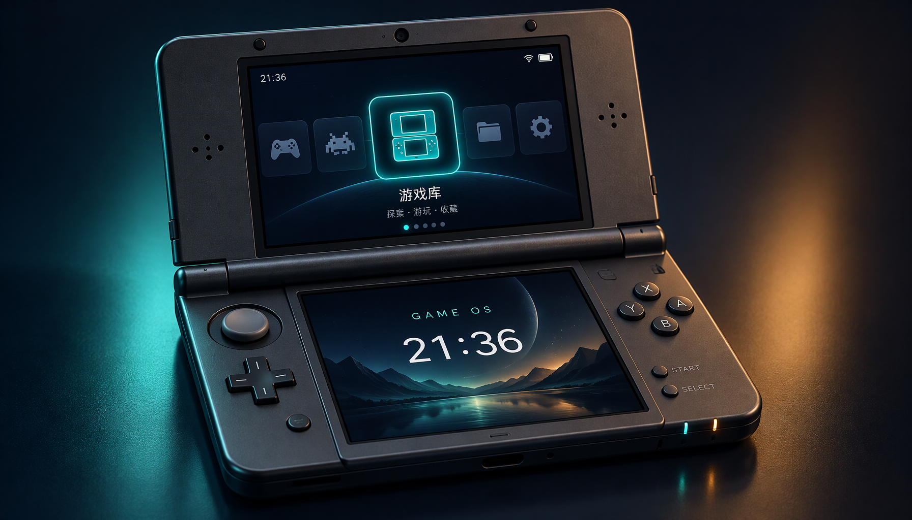

# gameOS

**为 Anbernic RG DS Plus 全新打造的游戏系统** —— 基于 Linux，从引导到界面全部自主构建。



## 特性

- **能启动，这是第一原则**：U-Boot v2026.01 采用 ROCKNIX 为 RG DS Plus
  准备的引导组合（quartz64 基础配置 + PMIC 电源键启动 + SD 卡优先引导），
  并补上 SPL 的 SD 卡读取能力（quartz64 原配置只支持 SPI 启动）；
  DDR 初始化用 RK3568 官方固件，内核设备树由 extlinux 显式指定，
  从根本上避开 BananaOS issue #183 的黑屏病根。
- **双屏 NDS 体验**：melonDS 核心（ARM64 JIT 加速）+ 双屏直出补丁，
  上屏显示上画面、下屏显示下画面并支持触摸，4 倍整数缩放，像素完美。
- **多平台**：NDS / GBA / GBC / PS1 / PSP，各平台均选用性能最优的模拟器。
- **全新自研界面**：SDL2 直写 DRM/KMS，无 X11/Wayland 中间层，
  全套图标与背景均为原创设计。
- **精简快速**：Buildroot 构建的精简 rootfs，开机直达游戏界面。

## 支持平台

| 平台 | 模拟器 | 加速 |
|------|--------|------|
| NDS | melonDS (libretro) | ARM64 JIT 动态编译 |
| GBA / GBC | mGBA (libretro) | ARM64 优化 |
| PS1 | PCSX-ReARMed (libretro) | ARM64 动态编译 |
| PSP | PPSSPP | Mali-G52 GPU (Panfrost) |

## 快速开始

1. 从 [Releases](https://github.com/oh-sudo-user/gameOS/releases) 下载最新 `gameOS-rgds-plus.img.gz`
2. 用 [balenaEtcher](https://etcher.balena.io/) 刷入 microSD 卡（≥16GB，推荐 Samsung / Kioxia）
3. 插入 RG DS Plus 的 TF1 槽，开机
4. 首次开机自动创建 GAMEOS 数据分区；把游戏 ROM 放入对应文件夹即可

详细教程见 [docs/FLASHING.md](docs/FLASHING.md)（中文）。

## 从源码构建

需要 Linux x86_64 主机（或直接用 GitHub Actions，仓库已配置好）：

```bash
./scripts/fetch-vendor.sh          # 拉取固定版本的内核补丁/设备树/固件
git clone --depth 1 -b 2026.08 https://github.com/buildroot/buildroot.git
cd buildroot
make BR2_EXTERNAL=../buildroot gameos_rgds_plus_defconfig
make -j$(nproc)
# 产物: output/images/gameOS-rgds-plus.img.gz
```

云端构建：推送代码后 GitHub Actions 自动编译并发布镜像，见 `.github/workflows/build.yml`。

## 系统架构

```
BootROM → idbloader (RK3568 DDR 固件 + SPL) → U-Boot (RG DS Plus 验证配置)
       → Linux 7.2.11 (主线内核 + RG DS Plus 设备树 + generic-dsi 双屏驱动)
       → gameOS rootfs (Buildroot)
       → gameos-inputd (手柄合并守护进程)
       → gameos-ui (自研 SDL2/DRM 前端)
       → RetroArch / PPSSPP (游戏运行)
```

详见 [docs/ARCHITECTURE.md](docs/ARCHITECTURE.md)。

## 许可证

- gameOS 自研代码（界面、输入守护、构建脚本、补丁）：GPL-3.0
- 集成的上游组件各自遵循其许可证（Linux: GPL-2.0，U-Boot: GPL-2.0+，
  melonDS: GPL-3.0，RetroArch: GPL-3.0，PPSSPP: GPL-2.0+，mGBA: MPL-2.0）
- Rockchip DDR/BL31 固件为 Rockchip 专有二进制，按 rkbin 仓库许可分发

## 致谢

硬件支持基础来自上游 Linux/U-Boot 社区与 ROCKNIX 项目的内核补丁集（GPL）。
gameOS 不包含 BananaOS 的任何代码。